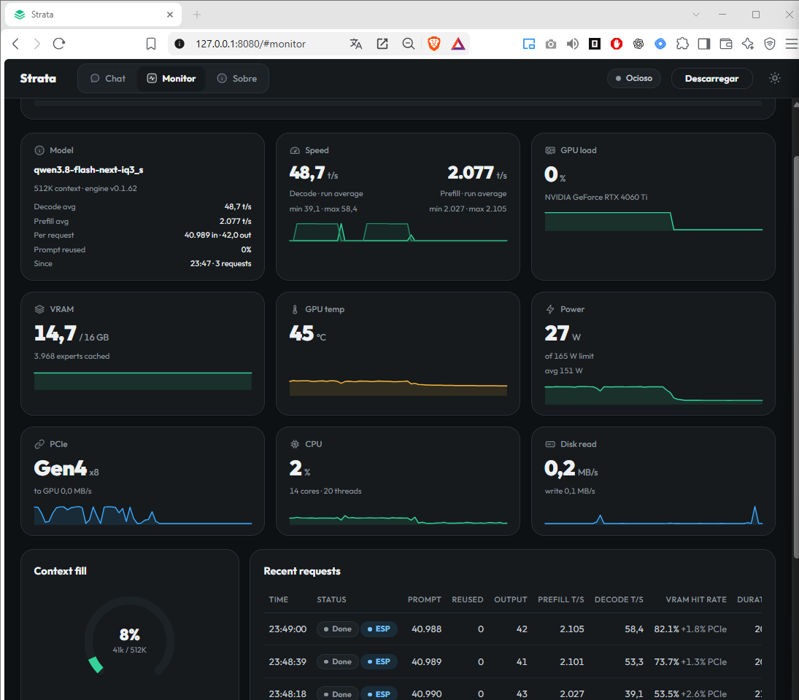
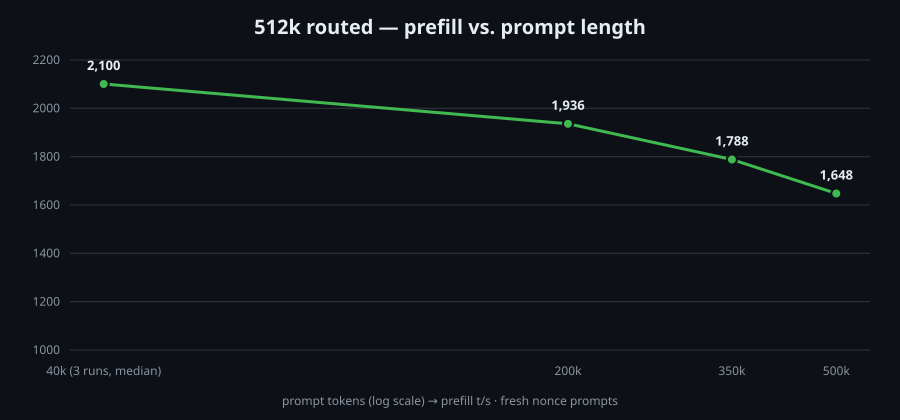
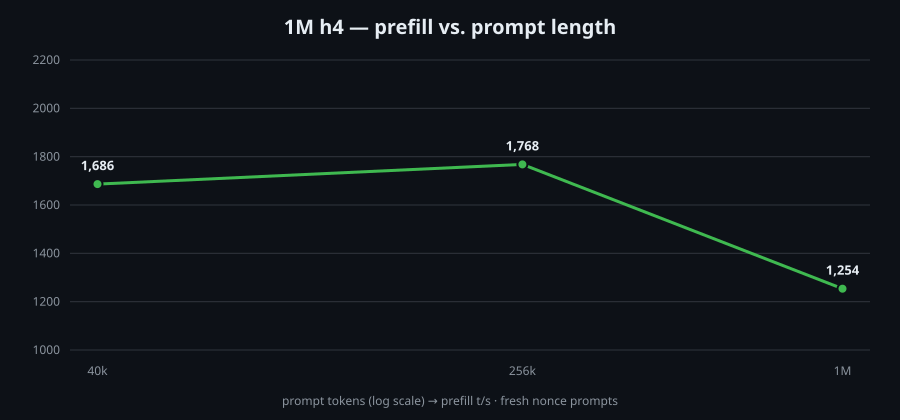

<div align="center">

# Strata / RTX 4060 Ti 16 GB + 64 GB DDR5

### **Prefill that makes upgrades optional.**

> *512K context is a working floor, not an expensive dream.*  
> <sub>“512k de contexto é piso de trabalho, não sonho caro.”</sub>

**Qwen3.8 Flash Next IQ3_S (ISTA-DASLab), 125B MoE** on one RTX 4060 Ti 16 GB **and 64 GB DDR5**. The
**512k speed preset** hits ~2,100 t/s at 40k; the separate **1M preset** holds
1,000,000 tokens without breaking. Two presets, two numbers — not both at 2,100.

[](https://github.com/Niko1221/Strata)
[](https://github.com/Niko1221/Strata)
[](presets/)
[](LICENSE)

**[Live page](docs/index.html)** · **[Recovery](recovery/RECOVERY.md)** · **[Downloads](#downloads)** · **[Presets](presets/)** · **[Launchers](launchers/)** · **[Raw curves](results/)** · **[Pitfalls](PITFALLS.md)** · **[Related numbers](RELATED.md)** · **[Community results](COMMUNITY.md)** · **[Notes for Strata](STRATA-NOTES.md)**



<sub>Strata's own monitor — <b>512k preset only</b>: 512K context, 2,077 t/s average, 2,105 peak, 14.7/16 GB VRAM. The 1M preset is a different, slower preset.</sub>

</div>

---

## Two presets, two jobs

| Preset | Window | Best measured | Long-prompt measured |
|---|---:|---:|---:|
| `strata-512k-routed` | 524,288 | **2,104.8 t/s** @ ~41k (median **2,100.5**) | 1,647.7 t/s @ 500k |
| `strata-1m-h4` | 1,048,576 | **1,767.8 t/s** @ ~263k | **1,253.7 t/s** @ 1,000,807 tokens |

### Decode, from the same runs

| Point | `strata-512k-routed` | `strata-1m-h4` |
|---|---:|---:|
| 40k | **53.3 t/s median** (58.4 peak), n=3 | 32.2 t/s |
| 200k / 350k / 500k | 42.2 / 45.2 / 42.4 t/s (256 gen) | — |
| 256k | — | 34.8 t/s |
| 1,000,807 tokens | — | 33.3 t/s |

The 40k benchmark client capped generation at 64 tokens and the runs emitted 38–43 tokens, so
these are short-answer decode samples — reported for context, **not** a long-output decode
record. The Strata panel on the 512k preset shows **48.7 t/s average** and **39.1–58.4 t/s**
min/max across the same three requests. Every figure here comes from one of the two shipped
presets. See [`results/README.md`](results/README.md) for exactly which log backs each number.

<p align="center">
  
  
</p>

> **Honest scope:** this is the fastest single-4060-Ti prefill I could find published for
> this model, but **I am not claiming a world record**. Two RTX 4060 Ti cards with 128 GB
> RAM have published ~2,410–2,650 t/s at 79k (`Niko1221/Strata#3976`), and there is no
> official leaderboard. Sources in [RELATED.md](RELATED.md).

---

## The part people skip

**The GPU alone is not enough.** These numbers need **64 GB of system RAM (DDR5, dual
channel)**. Strata keeps the whole 125B expert set in pinned host memory and streams only
the hot experts into VRAM. With 32 GB, IQ3_S spills to the SSD tier and you will not see
these speeds no matter which 16 GB card you put in the slot. At 1M, the `int8` K/V alone is
12.38 GiB of pinned RAM on top of a ~37 GiB page-locked expert complement.

| Part | Value |
|---|---|
| GPU | RTX 4060 Ti 16 GB (one card, VRAM OC via `Strata VRAM OC 10827.bat`) |
| Other apps | **iGPU is primary.** Browsers, Electron and desktop apps are pinned to the integrated GPU via `HKCU\Software\Microsoft\DirectX\UserGpuPreferences` (`GpuPreference=1`). The 4060 Ti's VRAM belongs to Strata alone — that is part of how 14.7/16 GB stays available for experts. |
| System RAM | **64 GB DDR5 — required** |
| Model | **Qwen3.8 Flash Next IQ3_S — ISTA-DASLab (GSQ-RCO), 125B MoE / 6B active** |
| Draft | DFlash2 tuned pack `qwen3.8-flash-next-dflash2.strata1.q4_0-selq4.pack` |
| Serving | Control 0.1.62 → engine 0.1.62, port 8080 |
| KV | `int8`, `--kv-resident 32768` |
| Vision | on, CPU tower (`vision.gpu: false`) |
| Abliteração | `--control-vector-scaled` + speed projection, layers 4–44 |
| Sampling | temperature 1, no `max_tokens` in preset |

---

## Downloads

- **[`presets/`](presets/)** — both champion configs as `.json.template`.
- **[`launchers/`](launchers/)** — two Windows `.bat` templates, one per preset, with no
  personal paths. Common practice for local Windows LLM projects; useful here because the
  boot order is easy to get wrong. Rename `.template` to `.bat` after copying.
- **[`results/`](results/)** — every raw JSONL: token counts, prefill, decode, TTFT, duration.
- **[`tools/`](tools/)** — the renderer and the realistic prompt benchmark.
- **[`docs/BOOT-ENV.md`](docs/BOOT-ENV.md)** — the boot environment, honestly documented.
  The pendrive ISO is **not included**: no verified image was available to ship.
- **[`STRATA-NOTES.md`](STRATA-NOTES.md)** — engine 0.1.62 / Control 0.1.62 findings and
  suggested upstream changes, 100% tied to the two presets below.
- **[`boot-unlock/`](boot-unlock/)** — ~81 MB unlocker payload with per-file SHA-256 and a
  script that rebuilds the pendrive from a blank USB stick.
- **[`recovery/RECOVERY.md`](recovery/RECOVERY.md)** + **[`verify.ps1`](verify.ps1)** —
  rebuild the whole stack after a clean Windows install; agent/API checklist included.
- **[`MODEL.md`](MODEL.md)** — why ISTA-DASLab GSQ-RCO IQ3_S, the near-BF16 quant.

## What is in this repo

- **`presets/`** — both champion configs as `.json.template`. No personal paths: fill in
  `${STRATA_ROOT}`, `${STRATA_DATA}`, `${PYTHON}`, `${CUDA_DLL_DIR}` with the renderer.
- **`tools/render_preset.py`** — writes a ready JSON and refuses to do so if
  `args != args_written`.
- **`tools/prefill_real_bench.py`** — the realistic corpus benchmark: runbook, C++ source,
  incident timeline, JSON snapshot, git diff, stack trace, design doc and a real debugging
  task. Fresh nonce every request.
- **`results/`** — raw JSONL: every request with token counts, `prompt_tps`, `decode_tps`,
  TTFT and duration.
- **[`PITFALLS.md`](PITFALLS.md)** — the five discarded levers and the 1M crash that cost a
  day.
- **[`RELATED.md`](RELATED.md)** — every public number I compared against, with links.
- **[`COMMUNITY.md`](COMMUNITY.md)** — bring your own GPU: result template and honest expectations.
- **[`docs/index.html`](docs/index.html)** — the landing page, ready for GitHub Pages.

No model weights or draft pack — those keep their own licenses. The unlocker payload IS included, with hashes, because it is the recovery path.

---

## The five levers that moved the needle

1. **`STRATA_PREFILL_RING=512`** — the big one. Plain `kv-resident` was ~1,720 t/s; ring512
   pushed it to ~2,098 t/s at 40k. Default ring 96 was the ceiling.
2. **`STRATA_PREFILL_ROUTED_STREAM=1`** — small but consistent win after a duel at
   200k / 350k / 500k.
3. **`--kv int8 --kv-resident 32768`** — `kv-grow` hits ~2,148 t/s at 40k but dies near 160k
   with `the K/V could not grow ... no VRAM is left`.
4. **`--rope-scale 4` + `STRATA_PREFILL_TAIL_LOAN=0`** — 1M only. Without tail-loan 0 the
   first request dies with `experts_native: an illegal memory access was encountered`.
5. **`STRATA_RESIDENT_HEADROOM_GIB=4`** — 1M only. Cuts the expert file tier from ~13 GiB to
   ~8.6 GiB for +4–10%. `=2` was tested and rejected: page-locking refused, no long-prompt
   gain, and only ~1.9 GiB RAM left free.

---

## Reproduce

```bash
python tools/render_preset.py presets/strata-512k-routed.json.template \
  --strata-root /path/to/Strata \
  --strata-data /path/to/Strata-data \
  --python /path/to/python.exe \
  --out strata-512k-routed.json

# start Control 0.1.62 with that config; wait for `window warm-up` in the log

python tools/prefill_real_bench.py --label my-40k --size 40960 --runs 3 \
  --max-tokens 64 --temperature 0 --out my-run.jsonl
```

Warm the engine with one short request first. Use fresh nonce-unique prompts, never reuse
one. Report medians, and quote the actual token count from the JSONL. Long ramps must run
detached from any agent shell — a child process gets killed at ~2 minutes mid-request.

---

MIT licensed. The model, draft pack and experimental-speed-projection vector keep their
own licenses — this repo ships configs and measurements only.
